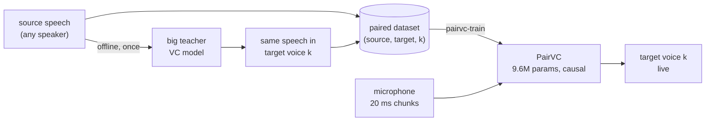

# tiny-pairvc

**PairVC: a tiny, real-time voice converter trained on paired speech.**

[](LICENSE)
[](pyproject.toml)
[](https://pytorch.org)
[](docs/inference.md#4-onnx-real-time-outside-pytorch)

PairVC turns your voice into one of N target voices, **live**: it is a fully
causal waveform-to-waveform network (9.6M parameters) that converts audio
**20 ms at a time on one CPU core** (6–11 ms per chunk), with 60 ms total
latency.

It is trained on **paired data**: every source clip comes with the *same
speech* already converted to each target voice by a big, slow, offline
teacher model. PairVC learns to reproduce the teacher's output sample for
sample (teacher → student distillation on synthetic parallel data), so it gets
the teacher's voices at a fraction of the cost.



Inside PairVC: a causal convolutional encoder squeezes the audio 320× into
64-dim latent frames (one per 20 ms), and a mirrored decoder rebuilds the
waveform in the target voice, conditioned on the speaker through FiLM layers.
It is trained as a GAN (multi-scale mel loss + HiFi-GAN-style discriminators).
See [docs/architecture.md](docs/architecture.md).

> **No pretrained weights are published.** You train PairVC on your own paired
> data (see [docs/data.md](docs/data.md)); a checkpoint is then saved in
> `checkpoints/run/`.

## Quick start

```bash
# 1. install (Python >= 3.10)
python -m venv .venv
source .venv/bin/activate
pip install -e '.[dev]'          # see docs/training.md for GPU / CPU-only torch

# 2. check everything works (CPU, no network, ~2 min)
pytest

# 3. sanity check on your data: can the model memorise 8 pairs?
pairvc-train --data-dir data --overfit 8 --max-steps 2000 --eval-every 200 \
             --output-dir checkpoints/overfit

# 4. real training (1 GPU; for several GPUs or machines see docs/training.md)
pairvc-train --data-dir data --output-dir checkpoints/run

# 5. use the trained model
pairvc-convert --checkpoint checkpoints/run/best.pt --input me.wav --speaker 0
pairvc-convert --checkpoint checkpoints/run/best.pt --input me.wav --speaker 0 --streaming  # + real-time factor
pairvc-export  --checkpoint checkpoints/run/best.pt --output pairvc.onnx --verify          # for live apps
```

## Documentation

| Guide | What is inside |
|-------|----------------|
| [notebooks/train_colab_kaggle.ipynb](notebooks/train_colab_kaggle.ipynb) | **Train on a free Kaggle or Colab GPU**: self-contained notebook, same config, live dashboard, listen to the results |
| [docs/data.md](docs/data.md) | What paired data is, the folder layout, how to build it with a teacher model |
| [docs/training.md](docs/training.md) | Train on CPU, one GPU, several GPUs, several machines (torchrun, SLURM); resume; memory; every flag |
| [docs/inference.md](docs/inference.md) | Convert files, stream chunk by chunk, export to ONNX for real-time apps |
| [docs/testing.md](docs/testing.md) | Unit tests, the overfit sanity check, what each test proves |
| [docs/architecture.md](docs/architecture.md) | How the model, streaming, losses and discriminators work, with tensor shapes |

## Repository layout

```
src/pairvc/            the package (read in this order)
  config.py            every hyperparameter: DataConfig, ModelConfig, DiscConfig, TrainConfig
  data.py              paired-file discovery, audio loading, cropping, toy dataset
  model.py             PairVC: causal encoder/decoder, FiLM, streaming step
  losses.py            multi-scale mel loss + least-squares GAN losses
  discriminators.py    multi-scale, multi-period, multi-resolution, multi-band
  train.py             GAN training loop: bf16, DDP, checkpoints, audio samples, CLI
  convert.py           inference CLI: file -> converted file (offline or streaming)
  export.py            streaming ONNX export + onnxruntime loop
notebooks/             Kaggle / Colab training notebook (+ the script that builds it from src/)
tests/                 pytest suite (CPU only, offline, synthetic data)
docs/                  guides
pyproject.toml         dependencies and the pairvc-train / -convert / -export commands
LICENSE                MIT
```

## Status and next steps

- [x] Clean data pipeline, model, GAN training loop, inference CLI, tests
- [x] One code path for training and streaming (streaming == whole clip, tested)
- [x] Single-GPU, multi-GPU and multi-node training (DDP)
- [x] Streaming ONNX export (verified against PyTorch), real-time factor report
- [x] Kaggle / Colab notebook (runs end to end on synthetic data)
- [ ] Full training run on real paired data, with listening tests
- [ ] Objective metrics in a separate eval script: UTMOS / DNSMOS (naturalness),
      speaker similarity to the teacher, CER with an ASR model (content kept)
- [ ] Live microphone demo (sounddevice + the ONNX graph)

## License

[MIT](LICENSE)
