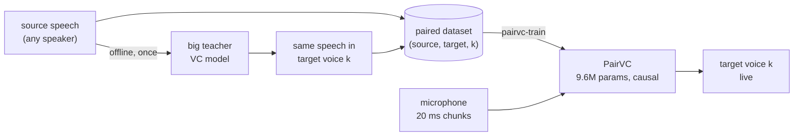
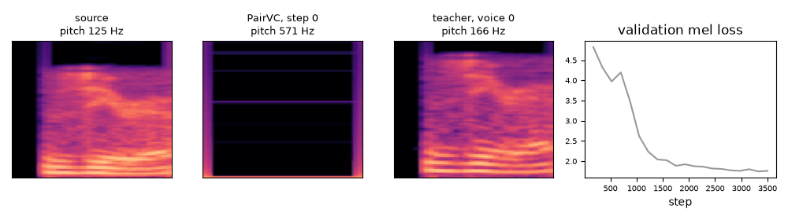
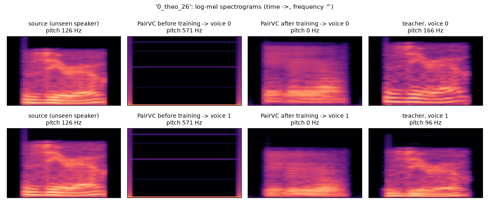

# tiny-pairvc

**PairVC: a tiny, real-time voice converter trained on paired speech.**

[](LICENSE)
[](pyproject.toml)
[](https://pytorch.org)
[](docs/inference.md#4-onnx-real-time-outside-pytorch)

PairVC turns your voice into one of N target voices, **live**: it is a fully
causal waveform-to-waveform network (9.6M parameters) that converts audio
**20 ms at a time on one CPU core** (6–11 ms per chunk), with 60 ms total
latency.

It is trained on **paired data**: every source clip comes with the *same
speech* already converted to each target voice by a big, slow, offline
teacher model. PairVC learns to reproduce the teacher's output sample for
sample (teacher → student distillation on synthetic parallel data), so it gets
the teacher's voices at a fraction of the cost.



Inside PairVC: a causal convolutional encoder squeezes the audio 320× into
64-dim latent frames (one per 20 ms), and a mirrored decoder rebuilds the
waveform in the target voice, conditioned on the speaker through FiLM layers.
It is trained as a GAN (multi-scale mel loss + HiFi-GAN-style discriminators).
See [docs/architecture.md](docs/architecture.md).

## Before and after training (real speech, unseen speaker)

A 0.67M-parameter PairVC (`--channels 8`) trained for 3500 steps **on a CPU**
(~1.5 h: 2500 mel-only warm-up steps, then 1000 GAN steps) on the
[spoken digits dataset](src/pairvc/digits.py): real recordings of 5 people saying
"zero" … "nine", converted by a pitch-shift "teacher" to a higher voice (+5
semitones, voice 0) and a deeper one (−5 semitones, voice 1). Everything below
is on a **sixth speaker never seen in training**. Reproduce it with
[`examples/`](examples/) 01, 02 (`--steps 3500`), 05 and 07.



*The validation clip at every evaluation: source, PairVC at that step, teacher, and the validation loss.*



| | metric (vs the teacher) | no conversion | PairVC untrained | **PairVC trained** | teacher |
|---|---|---:|---:|---:|---:|
| timbre | MCD dB ↓ | 6.53 | 12.62 | **2.70** | 0 |
| spectrum | mel L1 ↓ | 0.476 | 2.238 | **0.310** | 0 |
| naturalness | DNSMOS OVRL (1–5) ↑ | 2.17 | 1.15 | **1.88** | 2.27 |
| | DNSMOS SIG (1–5) ↑ | 2.62 | 1.14 | **2.09** | 2.58 |
| pitch | F0 RMSE cents ↓ | 525 | 2380 | **434** | 0 |
| | voicing agreement ↑ | 94.1 % | 37.4 % | **74.0 %** | 100 % |

80 held-out pairs; metrics in [docs/evaluation.md](docs/evaluation.md), raw
numbers in [assets/results.json](assets/results.json). DNSMOS is a neural
predictor of listening-test scores (the 8 kHz source recordings cap it near 2.3).
Streaming, 20 ms chunks on **one CPU thread**: RTF 0.29 (10 ms worst chunk),
60 ms latency, identical to offline conversion.

**What it learned, honestly:** timing, silences and the spectral envelope of
each target voice (MCD 6.5 → 2.7 dB, closer to the teacher than the source
is). **Not yet:** clean harmonics at the new pitch. The output is still
breathy, the pitch tracker finds few voiced frames, and the F0 error stays near
"no conversion". A tiny model after 1.5 h of CPU is not a finished voice
converter: the full-size model (9.6M) trained for hours on a GPU
([notebook](notebooks/train_colab_kaggle.ipynb), `USE_DIGITS_DATA = True`) is
the next step.

Listen (16 kHz wav):

| clip | source | voice 0 (+5 semitones) | voice 1 (−5 semitones) |
|---|---|---|---|
| "zero" | [source](https://github.com/benisalla/tiny-pairvc/raw/main/assets/audio/0_theo_26_source.wav) | [untrained](https://github.com/benisalla/tiny-pairvc/raw/main/assets/audio/0_theo_26_voice0_untrained.wav) · [**trained**](https://github.com/benisalla/tiny-pairvc/raw/main/assets/audio/0_theo_26_voice0_trained.wav) · [teacher](https://github.com/benisalla/tiny-pairvc/raw/main/assets/audio/0_theo_26_voice0_teacher.wav) | [untrained](https://github.com/benisalla/tiny-pairvc/raw/main/assets/audio/0_theo_26_voice1_untrained.wav) · [**trained**](https://github.com/benisalla/tiny-pairvc/raw/main/assets/audio/0_theo_26_voice1_trained.wav) · [teacher](https://github.com/benisalla/tiny-pairvc/raw/main/assets/audio/0_theo_26_voice1_teacher.wav) |
| "one" | [source](https://github.com/benisalla/tiny-pairvc/raw/main/assets/audio/1_theo_3_source.wav) | [untrained](https://github.com/benisalla/tiny-pairvc/raw/main/assets/audio/1_theo_3_voice0_untrained.wav) · [**trained**](https://github.com/benisalla/tiny-pairvc/raw/main/assets/audio/1_theo_3_voice0_trained.wav) · [teacher](https://github.com/benisalla/tiny-pairvc/raw/main/assets/audio/1_theo_3_voice0_teacher.wav) | [untrained](https://github.com/benisalla/tiny-pairvc/raw/main/assets/audio/1_theo_3_voice1_untrained.wav) · [**trained**](https://github.com/benisalla/tiny-pairvc/raw/main/assets/audio/1_theo_3_voice1_trained.wav) · [teacher](https://github.com/benisalla/tiny-pairvc/raw/main/assets/audio/1_theo_3_voice1_teacher.wav) |
| "two" | [source](https://github.com/benisalla/tiny-pairvc/raw/main/assets/audio/2_theo_14_source.wav) | [untrained](https://github.com/benisalla/tiny-pairvc/raw/main/assets/audio/2_theo_14_voice0_untrained.wav) · [**trained**](https://github.com/benisalla/tiny-pairvc/raw/main/assets/audio/2_theo_14_voice0_trained.wav) · [teacher](https://github.com/benisalla/tiny-pairvc/raw/main/assets/audio/2_theo_14_voice0_teacher.wav) | [untrained](https://github.com/benisalla/tiny-pairvc/raw/main/assets/audio/2_theo_14_voice1_untrained.wav) · [**trained**](https://github.com/benisalla/tiny-pairvc/raw/main/assets/audio/2_theo_14_voice1_trained.wav) · [teacher](https://github.com/benisalla/tiny-pairvc/raw/main/assets/audio/2_theo_14_voice1_teacher.wav) |

> **No pretrained weights are published.** You train PairVC on your own paired
> data (see [docs/data.md](docs/data.md)); a checkpoint is then saved in
> `checkpoints/run/`.

## Quick start

```bash
# 1. install (Python >= 3.10)
python -m venv .venv
source .venv/bin/activate
pip install -e '.[dev]'          # see docs/training.md for GPU / CPU-only torch

# 2. check everything works (CPU, no network, ~2 min)
pytest

# 3. sanity check on your data: can the model memorise 8 pairs?
pairvc-train --data-dir data --overfit 8 --max-steps 2000 --eval-every 200 \
             --output-dir checkpoints/overfit

# 4. real training (1 GPU; for several GPUs or machines see docs/training.md)
pairvc-train --data-dir data --output-dir checkpoints/run

# 5. use the trained model
pairvc-convert --checkpoint checkpoints/run/best.pt --input me.wav --speaker 0
pairvc-convert --checkpoint checkpoints/run/best.pt --input me.wav --speaker 0 --streaming  # + real-time factor
pairvc-export  --checkpoint checkpoints/run/best.pt --output pairvc.onnx --verify          # for live apps
pairvc-eval    --checkpoint checkpoints/run/best.pt --data-dir data --dnsmos                # metrics
```

No paired data yet? `python examples/01_build_digits_dataset.py` builds a real
speech one in a minute (see [Examples](#examples)).

## Examples

Short scripts using the package from Python, on the spoken digits dataset, all
runnable on a CPU ([examples/README.md](examples/README.md)):

| # | script | shows |
|---|--------|-------|
| 01 | [01_build_digits_dataset.py](examples/01_build_digits_dataset.py) | build a real-speech paired dataset (FSDD + pitch-shift teacher) |
| 02 | [02_train_on_digits.py](examples/02_train_on_digits.py) | train a small PairVC: mel-only warm-up, then GAN |
| 03 | [03_convert_a_file.py](examples/03_convert_a_file.py) | convert a recording to each target voice |
| 04 | [04_stream_in_real_time.py](examples/04_stream_in_real_time.py) | 20 ms chunks: real-time factor, latency, streaming == offline |
| 05 | [05_evaluate.py](examples/05_evaluate.py) | metrics before vs after training, with baselines (MCD, F0, DNSMOS) |
| 06 | [06_export_onnx.py](examples/06_export_onnx.py) | streaming ONNX export, run with onnxruntime |
| 07 | [07_before_after_demo.py](examples/07_before_after_demo.py) | the visuals and audio of this README |

## Documentation

| Guide | What is inside |
|-------|----------------|
| [notebooks/train_colab_kaggle.ipynb](notebooks/train_colab_kaggle.ipynb) | **Train on a free Kaggle or Colab GPU**: self-contained notebook, same config, live dashboard, listen to the results |
| [docs/data.md](docs/data.md) | What paired data is, the folder layout, how to build it with a teacher model |
| [docs/training.md](docs/training.md) | Train on CPU, one GPU, several GPUs, several machines (torchrun, SLURM); resume; memory; every flag |
| [docs/inference.md](docs/inference.md) | Convert files, stream chunk by chunk, export to ONNX for real-time apps |
| [docs/evaluation.md](docs/evaluation.md) | `pairvc-eval`: MCD, F0 error, voicing, DNSMOS; baselines; limits of each metric |
| [docs/testing.md](docs/testing.md) | Unit tests, the overfit sanity check, what each test proves |
| [docs/architecture.md](docs/architecture.md) | How the model, streaming, losses and discriminators work, with tensor shapes |

## Repository layout

```
src/pairvc/            the package (read in this order)
  config.py            every hyperparameter: DataConfig, ModelConfig, DiscConfig, TrainConfig
  data.py              paired-file discovery, audio loading, cropping, toy dataset
  digits.py            real-speech demo data: spoken digits + a phase-vocoder pitch-shift teacher
  model.py             PairVC: causal encoder/decoder, FiLM, streaming step
  losses.py            multi-scale mel loss + least-squares GAN losses
  discriminators.py    multi-scale, multi-period, multi-resolution, multi-band
  train.py             GAN training loop: bf16, DDP, checkpoints, audio samples, CLI
  convert.py           inference CLI: file -> converted file (offline or streaming)
  export.py            streaming ONNX export + onnxruntime loop
  metrics.py           MCD, YIN pitch error, voicing, mel L1, DNSMOS
  evaluate.py          pairvc-eval: score a checkpoint against the teacher, with baselines
examples/              numbered runnable scripts (build data, train, convert, stream, evaluate, export, demo)
assets/                README figures, GIF, audio and results (made by examples/07 and 05)
notebooks/             Kaggle / Colab training notebook (+ the script that builds it from src/)
tests/                 pytest suite (CPU only, offline, synthetic data)
docs/                  guides
pyproject.toml         dependencies and the pairvc-train / -convert / -export / -eval commands
LICENSE                MIT
```

## Status and next steps

- [x] Clean data pipeline, model, GAN training loop, inference CLI, tests
- [x] One code path for training and streaming (streaming == whole clip, tested)
- [x] Single-GPU, multi-GPU and multi-node training (DDP)
- [x] Streaming ONNX export (verified against PyTorch), real-time factor report
- [x] Kaggle / Colab notebook (runs end to end on synthetic data)
- [x] Objective metrics (`pairvc-eval`): MCD, F0 error, voicing, DNSMOS, with baselines
- [x] Real-speech demo on CPU (spoken digits, unseen speaker): before/after visuals, audio, metrics
- [ ] Full-size model on GPU until the converted pitch is clean (notebook, `USE_DIGITS_DATA = True`)
- [ ] Full training run on real teacher-converted data, with listening tests
- [ ] Speaker similarity (speaker-verification model) and CER (ASR model) metrics
- [ ] Live microphone demo (sounddevice + the ONNX graph)

## License

[MIT](LICENSE)
