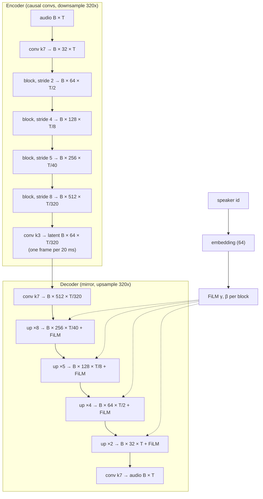

# How the model works

A short tour of the code with tensor shapes, for the default config.
B = batch size, T = audio samples (16 000 per second).

## 1. Data (`data.py`)

Each example is a source clip, the teacher's conversion of it, and the target
voice id (see [data.md](data.md)):

```
source [B, T]   target [B, T]   speaker [B]      (float audio in [-1, 1], 1 s crops)
```

## 2. The generator, PairVC (`model.py`)



- **Encoder block** = 3 residual units (dilations 1, 3, 9; each
  `x + ELU(conv1×1(ELU(conv7(x))))`) then a strided conv (kernel 2s, stride s).
- **Decoder block** = a transposed conv (kernel 2s, stride s), then 3 residual
  units.
- **FiLM** after each decoder block: `x · (1 + γ(spk)) + β(spk)` per channel.
  This is the only place the target voice enters, so the encoder learns a
  mostly speaker-independent representation of *what* is said.
- 9.6M parameters, receptive field ≈ 0.7 s of past audio
  (`PairVC.receptive_field()` measures it).

### Causality

Every conv is **causal**: it pads on the left only, so output sample t never
depends on input after t. For a conv with kernel k, dilation d, stride s the
left padding is `d·(k−1)+1 − s`, which also makes T inputs give exactly T/s
outputs. Transposed convs drop their last `k − s` outputs, the ones that would
still be waiting for the next frame. `tests/test_model.py` checks it: changing
the future of the input never changes the past of the output.

### Lookahead

A strictly causal model would have to speak the instant it hears a sound.
Instead, training compares output sample `t + 640` with target sample `t`
(`lookahead_frames = 2`, 40 ms): the model hears 40 ms of the future before it
produces each sample, which helps a lot with quality. The price is 40 ms of
extra latency. `PairVC.convert()` removes this delay for offline use, so the
output lines up with the input.

### Streaming (one code path)

Each layer has `forward(x)` (whole clip) and `step(x, states, new_states)`
(one chunk). A causal conv's state is the last `d·(k−1)+1 − s` input samples it
has not finished using; a transposed conv's state is the last input frame. The
model has 60 state tensors, all zeros at start.

```python
states = model.init_state(batch_size=1)
for chunk in chunks:  # [1, 320 * n]
    out, states = model.stream_step(chunk, speaker, states)
```

Because it is the same weights and the same arithmetic, streaming output
equals `forward` on the whole clip (tested for several chunk sizes, error
~1e-7). The chunk must be a whole number of frames (multiple of 320 samples).
The ONNX export is `stream_step` traced for one chunk size.

**Latency** = chunk (20 ms) + lookahead (40 ms) = 60 ms, plus your audio
driver's buffers.

## 3. Losses (`losses.py`)

```
G loss = 1 · adversarial + 2 · feature matching + 15 · multi-scale mel
D loss = Σ (1 − D(teacher))² + D(PairVC)²                  (least squares)
```

- **Multi-scale mel** (does most of the work): L1 between log10 mel
  spectrograms of PairVC's and the teacher's audio, at 7 window sizes
  (32 … 2048 samples with 5 … 320 mel bands), summed. Small windows judge
  timing and transients, large ones pitch and timbre.
- **Adversarial**: `(1 − D(PairVC))²`, PairVC wants to be scored "real".
- **Feature matching**: L1 between the discriminators' hidden activations on
  teacher and PairVC audio; a smooth, stable perceptual signal.

## 4. Discriminators (`discriminators.py`)

Only used in training. `--discriminators` picks any of:

| Name | What it looks at | Params |
|------|------------------|--------|
| `time` (default) | raw waveform at 1×, ½×, ¼× rate, strided grouped 1D convs (HiFi-GAN MSD) | 16.9M |
| `period` | waveform folded into 2D by periods 2, 3, 5, 7, 11 (HiFi-GAN MPD) | 41.1M |
| `resolution` | STFT magnitude at 3 resolutions (UnivNet MRD) | 0.3M |
| `band` | complex STFT split into 5 frequency bands (DAC MBD) | 1.4M |

`time` alone is the default: cheapest, and enough to remove most buzz.
`period` + `resolution` (HiFi-GAN v1 / UnivNet style) is a common stronger
choice if the audio sounds metallic or buzzy; it costs more memory.

## 5. One training step (`train.py: gan_step`)

```
prediction = G(source, speaker)                       # [B, T]
prediction, target = shift by lookahead               # [B, T − 640]
D step:  D(target, prediction.detach()) → D loss → update D
G step:  D frozen; D(target, prediction) → adv + fm;  mel(prediction, target)
         → G loss → update G
LR of both *= 0.9999996 after every step
```

With several GPUs both networks are wrapped in DistributedDataParallel; the G
step goes through the *unwrapped* D with its weights frozen (only gradients
w.r.t. the audio are needed there).
